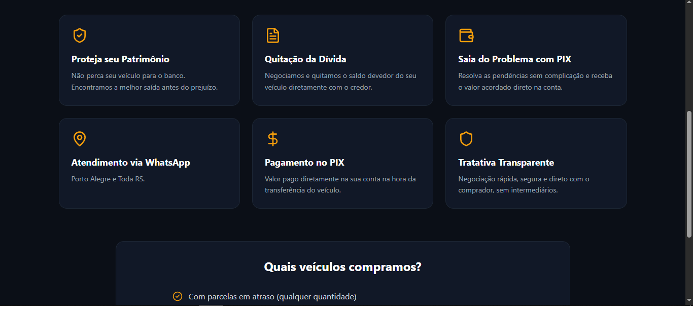
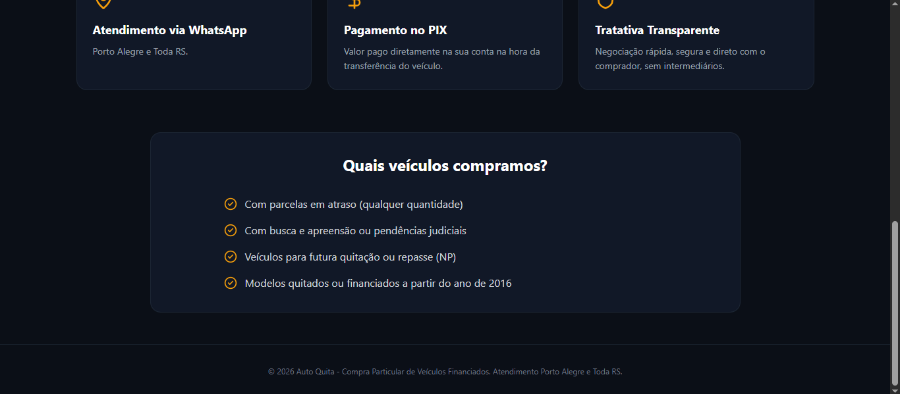
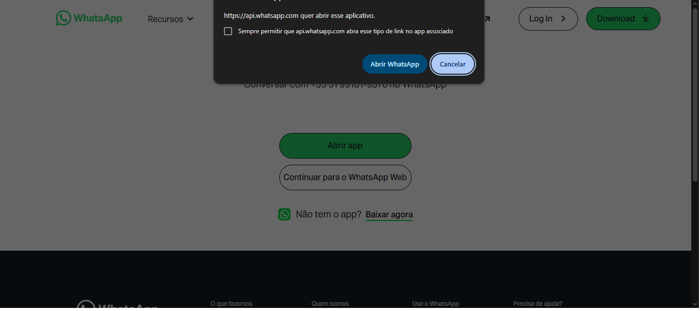

# 🚗 Auto Quita - Landing Page Profissional

Uma landing page moderna, acessível e otimizada para a **Auto Quita**, empresa especializada na negociação e quitação de veículos com pendências financeiras em Porto Alegre e Toda RS.

---

## 🎯 Propósito do Projeto

O site foi idealizado e desenvolvido com o objetivo principal de servir como um canal direto de conversão para clientes que desejam vender ou quitar seus veículos financiados. 

### Objetivos Principais:
- **Atendimento Autônomo:** Facilitar o contato imediato via integração direta com o WhatsApp.
- **Clareza de Informações:** Apresentar de forma simples e transparente os critérios de compra (ex: modelos a partir do ano de 2016 e veículos para futura quitação ou repasse).
- **Autoridade e Confiança:** Estabelecer a identidade visual da marca com um design elegante em tons escuros e detalhes dourados/âmbar (`selection:bg-amber-500`).





### 📱 Versão Mobile (Celular)


---

## 🛠️ Tecnologias Utilizadas e Estrutura do Código

O projeto foi construído focando em alta performance, sem dependências desnecessárias, garantindo um carregamento ultra-rápido:

- **HTML5 Semântico:** Estruturação limpa utilizando tags acessíveis (`<main>`, `<section>`, `<footer>`, atributos `aria-label` e `aria-hidden`) para garantir boa navegação e leitura por leitores de tela.
- **Tailwind CSS:** Utilizado para estilização rápida, responsiva e suporte a tema escuro personalizado (`bg-custom-dark`, `bg-custom-card`).
- **Lucide Icons:** Biblioteca leve utilizada para ícones vetoriais modernos (ex: `check-circle-2`).
- **Arquivos de Configuração e Otimização:**
  - `vercel.json`: Otimização de rotas e cabeçalhos de segurança (CSP e HTTP Security Headers).
  - `robots.txt`: Configurado para boas práticas de indexação em motores de busca (SEO).

---

## 🚀 Como o Código Foi Desenvolvido

1. **Acessibilidade & UI/UX:** Priorização de contraste e usabilidade. O uso de seleções personalizadas (`selection:bg-amber-500`) alinha o design com a identidade da marca enquanto mantém a legibilidade.
2. **Design Responsivo:** Layout adaptável feito com Tailwind CSS para garantir perfeita navegação tanto em smartphones quanto em desktops.
3. **SEO e Segurança:** Estrutura pronta para ser implantada na Vercel com regras de segurança ativas para proteger contra vulnerabilidades comuns na web.

---

## 🚨 Desafios Enfrentados e Aprendizados (Nicho & Marketing)

Durante o desenvolvimento e implantação do projeto, um dos maiores aprendizados envolveu a integração da landing page com as redes sociais da empresa:

* **Restrição de Links no Instagram:** 
  Ao tentar cadastrar o domínio do site recém-criado na biografia do perfil do Instagram no mesmo dia da criação da conta/site, identificamos uma limitação das diretrizes de segurança da plataforma. O Instagram bloqueia a inserção de links externos imediatos para perfis novos para evitar spam, exigindo um período de carência de **29 dias** para liberar essa funcionalidade.
* **Solução Temporária:** Foco na divulgação do contato direto via número/WhatsApp e produção de conteúdo orgânico enquanto o prazo da plataforma é concluído.

---

## ⚙️ Como Executar o Projeto Localmente

1. Clone este repositório:
   ```bash
   git clone [https://github.com/seu-usuario/landing-page-veiculos.git](https://github.com/seu-usuario/landing-page-veiculos.git)
